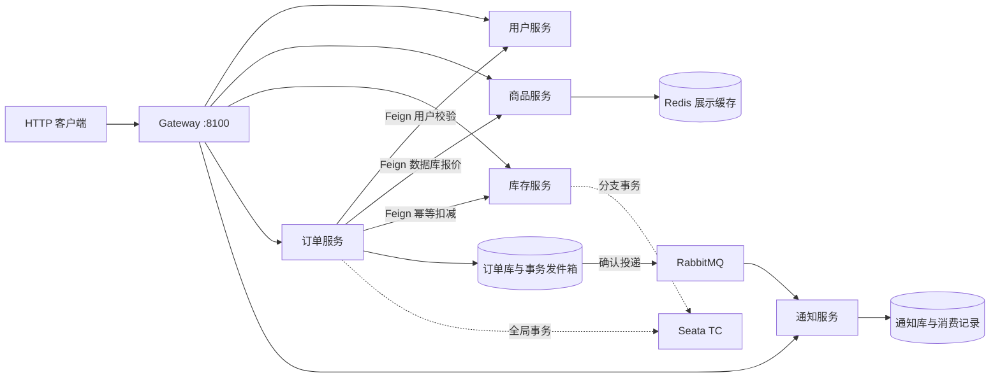

# Spring Cloud Alibaba Lab

## 项目介绍

Spring Cloud Alibaba Lab 是一个围绕下单场景构建的微服务学习与实战项目。通过用户校验、商品报价、库存扣减、订单确认和异步通知，逐步验证服务治理、数据持久化、缓存、消息可靠投递与分布式事务。

项目仅提供后端服务和 OpenAPI 接口文档，不包含前端。各服务独立启动、独立管理数据库，通过 HTTP 和消息交互；除了正常流程，也覆盖重复请求、并发争抢库存、中间件故障、响应丢失和事务回滚。

当前已实现 P1～P5，主要能力包括：

- **服务治理**：Nacos 注册发现与配置刷新、OpenFeign 服务调用、Gateway 统一入口与动态路由、Sentinel 限流与熔断及 Nacos 规则持久化。
- **订单与库存**：服务端报价、订单幂等、条件扣减防超卖，以及结果未知时沿原订单号查询和重试。
- **商品缓存**：Redis 展示缓存、更新后失效和故障时回退数据库；下单报价直接查询数据库。
- **异步通知**：事务发件箱、RabbitMQ 发布确认、消费幂等、有限重试、死信队列与人工重放。
- **分布式事务**：通过 Nacos 发现 Seata TC，使用 AT 全局下单、跨服务回滚及全局事务完成前的事件发布保护。

项目用于复习组件及其协作方式，业务范围止于下单和站内通知记录。`CONFIRMED` 表示订单已确认且库存已扣减，不代表付款或发货；认证权限、支付、物流及取消订单尚未实现。

## 环境与版本

以下为当前项目使用及本地验收的版本，依赖版本以根 [pom.xml](pom.xml) 和对应 BOM 为准。

| 组件 | 版本 | 用途 |
| --- | --- | --- |
| Java | 21 | 编译与运行 |
| Maven | 3.9.x | 多模块构建 |
| Spring Boot | 3.5.13 | 应用基础框架 |
| Spring Cloud | 2025.0.0 | 服务调用、网关及负载均衡 |
| Spring Cloud Alibaba | 2025.0.0.0 | Nacos、Sentinel、Seata 集成 |
| Nacos Client / Server | 3.0.3 / 3.0.3 | 注册发现与配置管理 |
| Sentinel Client / Dashboard | 1.8.9 / 1.8.9 | 限流与熔断 |
| MySQL | 8.0 | 各服务独立逻辑库 |
| Redis | 7 | 商品展示缓存 |
| RabbitMQ | 4.1.8-management | 订单事件与通知 |
| Seata Client / Server | 2.5.0 / 2.5.0 | AT 全局事务 |
| Seata TC MySQL JDBC 驱动 | Connector/J 8.0.33 | 构建 TC 镜像时单独加入，与业务服务依赖独立 |
| MyBatis-Plus | 3.5.12 | 数据访问 |
| MapStruct | 1.6.3 | 对象转换 |
| Flyway | 11.7.2 | 数据库版本迁移，由 Boot 管理 |
| springdoc-openapi | 2.8.17 | OpenAPI 与 Swagger UI |
| swagger-annotations-jakarta | 2.2.47 | 接口与模型注解 |

开发需要 Java 21 和 Maven 3.9.x；使用 Compose 时还需要 Docker Engine / OrbStack 与 Docker Compose。项目提供独立中间件启动配置，也支持复用已有中间件。Java 服务继续在 IDEA 或宿主机终端运行。

| 中间件 | 默认访问端口 | 说明 |
| --- | --- | --- |
| MySQL | 3306 | JDBC 连接 |
| Redis | 6379 | 缓存连接 |
| Nacos | 8848、9848；控制台 8080 | 应用使用 8848，客户端还需访问 gRPC 端口 9848 |
| Sentinel | Dashboard 8858、订单客户端 8719 | Dashboard 需要能反向访问客户端命令端口 |
| RabbitMQ | AMQP 5672、管理端 15672 | 项目使用独立 vhost |
| Seata | 8091 | TC 事务协调端口 |

## 模块职责

```text
spring-cloud-alibaba-lab/
├── pom.xml                         # 聚合模块与统一依赖版本
├── cloud-common/                   # 按需引用的公共能力
│   ├── cloud-common-core/          # 统一响应、业务异常、SDK 运行目录
│   ├── cloud-common-web/           # MVC 异常处理、请求 ID、接口文档
│   ├── cloud-common-mybatis/       # MyBatis-Plus、MySQL、Flyway、MapStruct 依赖
│   └── cloud-common-rabbit/        # AMQP 公共配置与消息拓扑
├── cloud-api/                      # 服务契约，不包含业务实现
│   ├── cloud-user-api/             # 用户 DTO 与 Feign 契约
│   ├── cloud-product-api/          # 商品报价 DTO 与 Feign 契约
│   ├── cloud-stock-api/            # 库存查询、幂等扣减与全局扣减契约
│   └── cloud-order-api/            # 订单确认事件 V1 契约
├── cloud-gateway/                  # WebFlux / Netty 网关
├── cloud-services/
│   ├── cloud-user/                 # 用户查询与购买资格校验
│   ├── cloud-order/                # 下单编排、订单状态、事务发件箱
│   ├── cloud-product/              # 商品管理、数据库报价与展示缓存
│   ├── cloud-stock/                # 库存查询、幂等扣减与防超卖
│   └── cloud-notification/         # 幂等消费、站内通知记录、死信重放
├── docs/                           # 配置样例、分阶段验收及 HTTP 请求
├── compose.yaml                    # 独立中间件环境定义
├── docker/                         # 中间件初始化与 Sentinel / Seata 镜像构建
└── sql/                            # MySQL 业务库及 Seata TC 初始化
```

| 运行模块 | 默认端口 | 默认数据库 | 职责 |
| --- | --- | --- | --- |
| cloud-gateway | 8100 | — | 服务发现与路由，提供 `/api` 业务入口 |
| cloud-user | 8101 | cloud_user | 用户状态查询 |
| cloud-order | 8102 | cloud_order | 预览、本地下单、全局下单、订单与事件查询 |
| cloud-product | 8103 | cloud_product | 商品展示、版本校验更新、下单报价 |
| cloud-stock | 8104 | cloud_stock | 库存快照、原子扣减、幂等记录 |
| cloud-notification | 8105 | cloud_notification | 订单确认事件消费与通知查询 |

业务服务通过 `cloud-api` 引用契约，不直接依赖其他服务的实现。Entity、Mapper 和 Flyway migration 由各服务自行管理。Gateway 仅引用公共 core 模块，不引入 MVC、数据库或消息依赖。

## 架构与业务流程



Nacos 为网关与业务服务提供注册发现和配置管理；Sentinel 保护订单预览入口及用户远程查询。各数据服务拥有独立 MySQL 逻辑库，图中重点展示订单事件链路。

### 两种下单方式

预览接口只校验用户、读取商品数据库报价和库存快照，不生成订单或扣减库存。正式下单由服务端计算金额，客户端不提交价格。

| 方式 | 网关入口 | 一致性处理 | 异常后处理 |
| --- | --- | --- | --- |
| LOCAL 本地下单 | `POST /api/orders` | 先保存订单意图，再通过库存幂等接口扣减并确认结果 | 库存不足保留拒绝订单；结果未知时查询并重试原订单 |
| GLOBAL 全局下单 | `POST /api/orders/atomic` | Seata AT 管理订单、库存和发件箱的数据库事务 | 异常触发全局回滚；保留原请求号查询最终结果 |

LOCAL 订单状态包括 `PENDING_STOCK`、`CONFIRMED`、`REJECTED` 和 `RECONCILE_REQUIRED`。库存通过唯一订单号和条件更新防止重复扣减及超卖；原订单重试沿用价格快照。

GLOBAL 库存不足或分支异常时回滚订单、扣减记录与事件，不保留 LOCAL 流程的拒绝订单。HTTP 超时或 503 不能直接证明回滚已完成，应保留原请求号查询；完全回滚后再次全局下单会重新校验当前报价。相同请求号不能混用 LOCAL 和 GLOBAL 接口。

### 订单事件与通知

订单确认和事件写入同一数据库事务。发件箱后台投递使用 RabbitMQ confirms/returns；通知服务在一个本地事务内保存消费记录和站内通知，通过事件 ID 与业务唯一约束实现幂等，失败有限重试后进入死信队列。

Seata AT 一阶段提交的数据可能已经对其他连接可见，因此发件箱领取及人工重试还会检查全局锁，避免全局事务结束前发送事件。事件 `SENT` 仅表示 broker 已接收，实际消费结果需查询通知接口。

## 启动指南

日常使用分为启动服务和调用接口，进阶故障实验按需执行：

| 入口 | 使用方式 |
| --- | --- |
| 运行项目 | 准备中间件、填写连接配置，在 IDEA 或终端启动六个服务 |
| 调用接口 | 使用各服务 Swagger 或 [requests.http](docs/requests.http) |

### 1. 选择中间件环境

**复用已有环境**：按 [.env.example](.env.example) 填写 `.env`，准备五个业务库、项目账号、RabbitMQ vhost、六个业务 YAML、三个规则/路由 JSON Data ID 和 Seata TC。已有 `.env` 时保留并编辑，无需启动 Compose。

**独立 Compose 环境**：首次复制 [.env.compose.example](.env.compose.example) 为 `.env.compose`，填写密码、Nacos JWT 密钥和实际宿主机 IP（`SEATA_ADVERTISED_IP`），再运行：

```bash
docker compose --env-file .env.compose config --quiet
docker compose --env-file .env.compose up -d --build
docker compose --env-file .env.compose ps -a
docker compose --env-file .env.compose logs nacos-init
```

Compose 准备 MySQL、Redis、Nacos、RabbitMQ、Sentinel 和 Seata。MySQL 首次初始化创建业务库与账号、Seata 存储；Nacos 初始化任务补齐配置，保留已有 Data ID；RabbitMQ 首次创建用户与项目 vhost。确认中间件可用且 `nacos-init` 退出码为 0，再启动 Java。

Seata 使用 [Dockerfile](docker/seata/Dockerfile) 基于官方 2.5.0 镜像构建，自动下载并校验 MySQL Connector/J 8.0.33，放入 `/seata-server/libs/jdbc/`。TC 使用 MySQL 存储必须提供该驱动；Java 业务服务中的 MySQL Maven 依赖不会为 TC 容器提供驱动。首次构建需要访问 Maven Central，无需手动下载或提交 JAR。

默认宿主机端口为 MySQL **13306**、Redis **16379**、Nacos API / gRPC / 控制台 **18848 / 19848 / 18080**、RabbitMQ AMQP / 管理端 **15673 / 25672**、Sentinel **18858**、Seata **18091**，用于避开常用的已有环境端口。

完整前置条件、初始化、端口调整和数据卷说明见 [环境与配置指南](docs/environment.md)。Compose 面向本地开发，已在独立项目名及全新数据卷下完成首次初始化、六服务下单联调与中间件重启验收。

### 2. 编译项目

确认 `java -version` 和 `mvn -version` 均使用 Java 21，在项目根目录执行：

```bash
mvn clean package
```

IDEA 打开根 `pom.xml` 导入全部模块，将 Project SDK、语言级别和 Maven Runner JRE 设置为 21。

### 3. 启动 Java 服务

IDEA 在各服务运行配置中填写所需环境变量。已有环境参考 `.env`，独立 Compose 环境参考 `.env.compose`；Java 不会自动加载这两个文件。

终端运行时，每个终端在项目根目录加载所选文件：

```bash
set -a
source .env          # 独立 Compose 环境改为 source .env.compose
set +a
```

随后在独立终端分别启动，建议先用户、商品、库存、通知，再订单、网关：

```bash
java -jar cloud-services/cloud-user/target/cloud-user-1.0.0-SNAPSHOT.jar
java -jar cloud-services/cloud-product/target/cloud-product-1.0.0-SNAPSHOT.jar
java -jar cloud-services/cloud-stock/target/cloud-stock-1.0.0-SNAPSHOT.jar
java -jar cloud-services/cloud-notification/target/cloud-notification-1.0.0-SNAPSHOT.jar
java -jar cloud-services/cloud-order/target/cloud-order-1.0.0-SNAPSHOT.jar
java -jar cloud-gateway/target/cloud-gateway-1.0.0-SNAPSHOT.jar
```

IDEA 运行对应 `*Application` 主类。各服务 `/actuator/health` 用于检查健康状态。

正常运行默认 `nacos` profile，必需导入远程配置；Nacos 或 Data ID 不可用时不自动退回其他业务模式。消息、Seata、Sentinel 数据源配置分别放在服务内 `config/messaging.yml`、`config/seata.yml`、`config/sentinel.yml`，由基础配置显式导入。

Gateway 从 `cloud-gateway-routes.json` 读取路由；同一业务命名空间和 Group 中发布后，无需重启即可更新。首次缺失或无效时启动失败，运行中无效更新保留旧路由。配置格式与手工验证见 [动态路由说明](docs/dynamic-routing.md)。

各服务使用自己的默认 schema，不要给全部运行配置设置同一个 `DB_SCHEMA`。订单、库存启用 `SEATA_ENABLED=true` 后，通过 Nacos 发现 TC，才能使用 GLOBAL 全局下单。默认注册信息为 `seata-server` / `SEATA_GROUP` / public / `default`，与业务服务的 `LAB_GROUP` 独立；配置对应关系见 [环境指南](docs/environment.md#seata-注册发现)。

## 接口文档与调用示例

| 服务 | Swagger UI |
| --- | --- |
| 用户 | [localhost:8101/swagger-ui/index.html](http://localhost:8101/swagger-ui/index.html) |
| 订单 | [localhost:8102/swagger-ui/index.html](http://localhost:8102/swagger-ui/index.html) |
| 商品 | [localhost:8103/swagger-ui/index.html](http://localhost:8103/swagger-ui/index.html) |
| 库存 | [localhost:8104/swagger-ui/index.html](http://localhost:8104/swagger-ui/index.html) |
| 通知 | [localhost:8105/swagger-ui/index.html](http://localhost:8105/swagger-ui/index.html) |

各业务服务通过 `/v3/api-docs` 提供 OpenAPI JSON。Gateway 对外提供以下业务路由，转发时移除 `/api` 前缀；Swagger、Actuator 和 `/internal/**` 不通过网关暴露。

| 方法与网关路径 | 用途 |
| --- | --- |
| `GET /api/users/{id}` | 查询用户 |
| `GET /api/products/{id}`、`PUT /api/products/{id}` | 商品展示、按版本更新 |
| `GET /api/stocks/{id}` | 查询库存 |
| `POST /api/orders/preview` | 订单预览 |
| `POST /api/orders` | LOCAL 本地下单 |
| `POST /api/orders/atomic` | GLOBAL 全局下单 |
| `GET /api/orders/{orderNo}` | 查询订单及事务模式 |
| `POST /api/orders/{orderNo}/retry` | 重试 LOCAL 原订单 |
| `GET /api/orders/events/by-order/{orderNo}` | 查询订单确认事件 |
| `POST /api/orders/events/{id}/retry` | 人工重试事件投递 |
| `GET /api/notifications/orders/{orderNo}` | 查询站内通知记录 |
| `POST /api/notifications/dead-letters/replay-one` | 重放一条死信 |

通过网关提交本地订单：

```bash
curl -X POST http://localhost:8100/api/orders \
  -H 'Content-Type: application/json' \
  -d '{"requestNo":"order-demo-0001","userId":1,"productId":1001,"quantity":2}'
```

`requestNo` 为 8～64 位小写 ASCII 字母、数字、`_` 或 `-`。重复请求沿用原值，同号不同购买参数返回 409；结果未知时先查询原订单，不能直接换新号下单。

默认初始化数据中，用户 `1` 正常、用户 `2` 禁用；商品 `1001` 单价 29.90、初始库存 20，商品 `1002` 单价 49.90、初始库存 5。执行下单后库存会变化。

统一响应包含 `code`、`message`、`data`、`timestamp`。成功业务码为 `200`，失败同时返回对应 HTTP 错误状态；`X-Request-Id` 在服务调用间传递，`X-Service-Instance` 可辅助观察请求落到哪个实例。

更多请求见 [docs/requests.http](docs/requests.http)，可直接使用 IDEA HTTP Client 调用。

## 接口验证与可选实验

服务启动后，使用 Swagger 或 [requests.http](docs/requests.http) 查询用户、商品与库存，执行订单预览、LOCAL / GLOBAL 下单、原号重复提交及通知查询。结合接口响应、数据库记录和日志核对结果，操作清单见 [接口验证说明](docs/verification.md)。

需要深入学习配置推送、限流熔断、消息故障和事务回滚时，再阅读 P1～P5 阶段文档；这些实验不属于启动项目的前置步骤。涉及故障注入时使用单独的实验资源。

**联调记录（2026-10-13）**：独立 Compose 从全新数据卷完成初始化，六服务启动、鉴权注册发现、LOCAL / GLOBAL 原号幂等下单、RabbitMQ 通知及库存不足回滚通过；中间件重启后账号和业务数据保留。Sentinel 规则热更新、订单重启加载及熔断恢复通过；动态路由新增、删除、上游修改、无效更新保护、重启加载与并发更新通过。

## 学习阶段与文档入口

| 阶段 | 已实现内容 | 操作与验证 |
| --- | --- | --- |
| P1 | Nacos、OpenFeign、配置刷新、统一响应与 OpenAPI | [P1 验证说明](docs/p1-verification.md) |
| P2 | Gateway 动态路由、负载均衡、Sentinel 限流与熔断及规则持久化 | [P2 验证说明](docs/p2-verification.md) |
| P3 | MySQL、MyBatis-Plus、MapStruct、Redis、订单与库存 | [P3 验证说明](docs/p3-verification.md) |
| P4 | RabbitMQ、事务发件箱、消费幂等、重试与死信 | [P4 验证说明](docs/p4-verification.md) |
| P5 | Seata AT 全局下单、异常回滚与事件保护 | [P5 验证说明](docs/p5-verification.md) |

## 运行约定与当前边界

- **配置与凭据**：`.env`、`.env.compose` 与 `.runtime` 保存本机参数，已加入 Git 忽略规则。仓库仅保留示例模板。
- **日志与缓存**：客户端运行文件默认位于 `.runtime/<服务名>/`，Nacos 使用 `logs/nacos` 和 `cache/nacos`，订单 Sentinel 使用 `logs/sentinel`。`.runtime` 与构建产物均被忽略。
- **Sentinel 规则**：流控和熔断规则以 Nacos 中的 JSON 为准，客户端重启后自动加载。Dashboard 默认修改客户端内存，不会回写 Nacos；持久化变更在 Nacos 发布。限流按实例生效，不代表集群总 QPS。
- **数据库职责**：根 `sql/` 管理环境初始化，各服务 `resources/db/migration` 管理业务表版本；历史 migration 保持原始内容。
- **缓存一致性**：Redis 故障时商品展示回退数据库，更新后的缓存失效若失败需等待 30 秒 TTL；下单报价始终来自数据库。
- **人工恢复**：LOCAL 未知订单通过原号查询和重试，失败事件与死信提供人工入口；尚未实现订单自动对账任务。
- **通知范围**：当前生成站内通知数据库记录，不发送邮件或短信。认证权限按后续学习需求逐步加入。

## 许可证

本项目采用 [Apache License 2.0](LICENSE)。Copyright © 2026 xuesong.lei。

引用的 Seata SQL 保留原始许可、来源及修改说明，相关第三方归属信息见 [NOTICE](NOTICE)。
