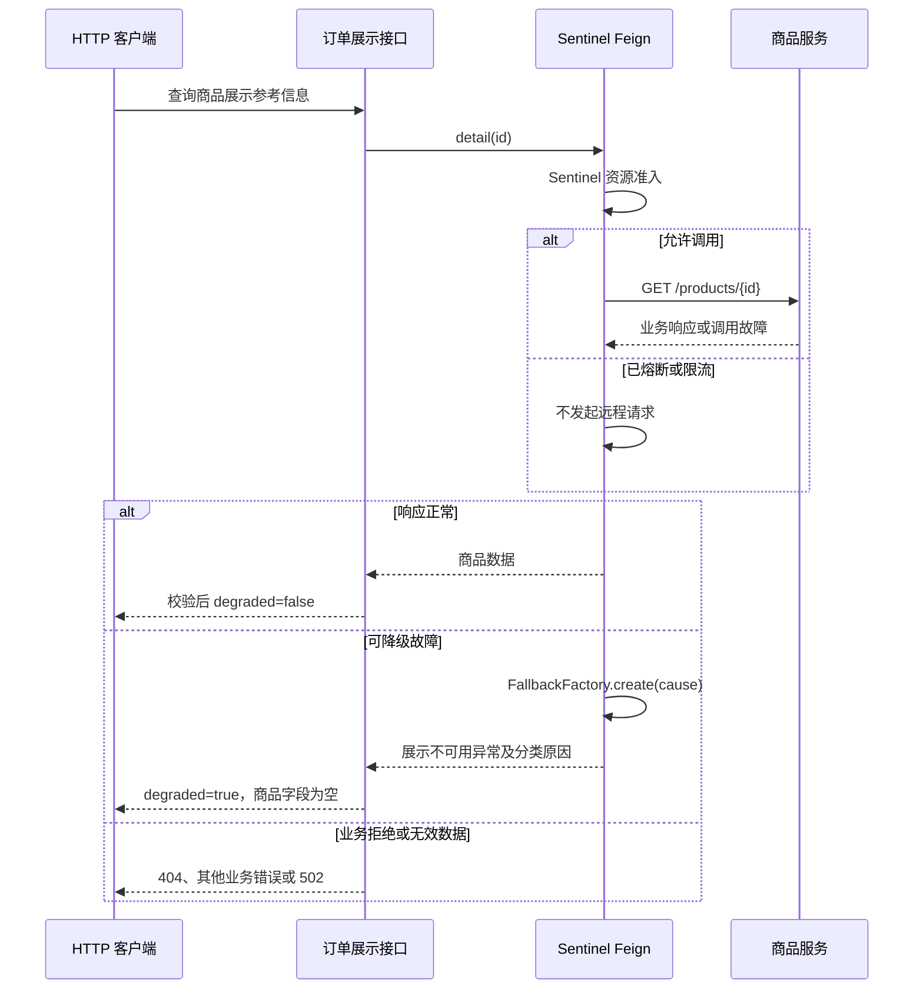

# Feign 故障与降级学习

本阶段在订单服务中增加可选商品展示信息，对照已有的关键用户校验与数据库报价。展示故障时省略信息，关键依赖故障时停止下单；降级不等于成功完成原始远程操作。

## 从接口看行为

通过网关统一 Swagger，选择订单服务，找到“订单商品展示与降级”，或执行：

```http
GET http://localhost:8100/api/orders/products/1001/display
```

正常返回 `degraded=false`、`reason=NONE`，带商品名称、展示参考价格与上架状态。依赖故障时返回 HTTP 200，但数据明确变为：

```json
{
  "productId": 1001,
  "name": null,
  "displayPrice": null,
  "enabled": null,
  "degraded": true,
  "reason": "UNAVAILABLE"
}
```

上例是统一 `Result` 中的 `data`，表示展示内容暂不可用，不代表商品存在、上架或允许购买。没有返回假价格，也没有默认允许下单。若商品服务明确返回 404，接口仍返回 404；返回无效 JSON、错误商品 ID 或不完整契约时返回 502。

## 按顺序读源码

1. [ProductDisplayController](../cloud-services/cloud-order/src/main/java/cn/oomecho/cloud/order/controller/ProductDisplayController.java)：公开展示入口和参数校验。
2. [ProductDisplayGateway](../cloud-services/cloud-order/src/main/java/cn/oomecho/cloud/order/integration/ProductDisplayGateway.java)：校验正常响应，将明确的展示不可用异常转换成降级 VO。
3. [ProductDisplayClient](../cloud-services/cloud-order/src/main/java/cn/oomecho/cloud/order/integration/feign/ProductDisplayClient.java)：消费者专属 Feign 客户端，读取商品展示接口 `/products/{id}`，声明 `fallbackFactory`。
4. [ProductDisplayFallbackFactory](../cloud-services/cloud-order/src/main/java/cn/oomecho/cloud/order/integration/feign/ProductDisplayFallbackFactory.java)：取得本次原始异常，区分业务拒绝、超时、故障、限流和熔断。
5. [ProductDisplayVO](../cloud-services/cloud-order/src/main/java/cn/oomecho/cloud/order/domain/vo/ProductDisplayVO.java)：可明确识别的正常或部分信息响应。



Factory 不是新的远程服务，而是本地回退策略。它每次创建仅绑定本次异常的回退实例，不用共享可变字段保存请求状态。回退方法可以返回替代结果，也可以抛出异常；这里由 Factory 抛出携带原因的专用信号，再由适配层生成降级结果。

## 超时、熔断、回退与重试

| 原因 | reason | 是否发起远程请求 |
| --- | --- | --- |
| 超时 | TIMEOUT | 已尝试连接或读取，到超时边界结束 |
| 无可用实例、连接失败或 5xx | UNAVAILABLE | 尝试调用；无实例时可能在负载均衡阶段失败 |
| Sentinel 熔断器打开 | CIRCUIT_OPEN | 否 |
| Sentinel 限流或上游 429 | RATE_LIMITED | Sentinel 拦截时不调用，上游 429 则已经调用 |

超时控制等待时长；熔断根据历史调用统计暂停请求；回退决定失败后业务怎样表达结果；重试决定是否再次调用。四者不能混为一谈。本项目的共享 `Retryer.NEVER_RETRY` 和关闭的负载均衡重试仍然生效，展示请求也不会自动重试。

`FallbackFactory` 能取得原因，普通 `fallback` 只提供统一替代实现。两者都需要实际集成，本阶段使用项目现有 Sentinel，不添加 Resilience4j，不同时打开另一套 Feign CircuitBreaker。

## 客户端配置与规则

[ProductDisplayFeignConfiguration](../cloud-services/cloud-order/src/main/java/cn/oomecho/cloud/order/integration/feign/ProductDisplayFeignConfiguration.java) 只为展示客户端创建 Sentinel Builder，没有 `@Configuration`，避免被主应用扫描为全局配置。当前 Alibaba 2025.0.0.0 的 Sentinel Builder 从主应用读取客户端元数据，因此工厂显式使用 Feign 子上下文的父上下文；先理解业务调用链，再阅读这一版本集成细节。

原用户校验、报价和库存客户端继续使用原配置。没有全局设置 `feign.sentinel.enabled=true`，不会给写调用附加展示回退策略。共享 API 模块也没有新增消费者的回退实现。

[FeignClientConfiguration](../cloud-services/cloud-order/src/main/java/cn/oomecho/cloud/order/config/FeignClientConfiguration.java) 中的异常统计谓词作用于订单进程：明确的 HTTP 4xx 业务拒绝不计为服务故障；429、5xx、连接失败、超时和解码异常保留统计。该设置不改变 HTTP 响应。已有 `UserGateway` 仍在 `user:query` 资源上只统计服务故障。

将更新后的 [cloud-order-degrade.json](nacos/cloud-order-degrade.json) 发布到业务 Namespace 与 Group，保留已有 `user:query` 规则，并新增：

```text
GET:http://cloud-product/products/{id}
```

这是 Sentinel Feign 按 HTTP 方法、客户端目标和路径模板生成的资源名，不是某一次请求的数字 ID。通过服务发现运行时目标是 `http://cloud-product`；若设置 `clients.product.url` 直连地址，资源名也会随目标变化，实验规则必须对应修改。

默认规则为异常比例达到 0.5、10 秒统计窗口内至少 5 次请求、熔断 10 秒。窗口结束后允许半开探测，成功后恢复，失败则再次熔断。Nacos 更新规则可以热加载；Dashboard 手工修改仍只改内存。

## 为什么正式下单不能使用这个结果

[UserGateway](../cloud-services/cloud-order/src/main/java/cn/oomecho/cloud/order/integration/UserGateway.java) 必须确认用户是否允许购买；故障不能默认允许。[ProductGateway](../cloud-services/cloud-order/src/main/java/cn/oomecho/cloud/order/integration/ProductGateway.java) 查询数据库报价，不能使用展示参考价或降级结果。[StockGateway](../cloud-services/cloud-order/src/main/java/cn/oomecho/cloud/order/integration/StockGateway.java) 的扣减超时表示结果待确认，不能返回默认成功或默认失败。

因此商品展示故障可以返回部分信息，而订单预览、首次 LOCAL 下单仍明确失败。两种策略按业务重要性区分，不取决于“有没有写 fallback”。

## 手工学习与验收

1. 服务正常时请求展示接口，再预览订单，对照正常数据。
2. 停止商品服务，展示应返回降级结果，预览应拒绝报价；服务发现更新存在延迟，可结合日志观察连接失败和无实例两种过程。
3. 在统计窗口内连续制造展示故障，观察 `UNAVAILABLE` 变为 `CIRCUIT_OPEN`；日志记录商品 ID、原因和异常类型，公共日志模式包含请求 ID。
4. 恢复商品服务，等待熔断窗口结束，观察半开探测后恢复正常。
5. 服务正常时查询不存在商品，应为 404；连续 404 不应触发异常比例熔断。停止用户服务时，下单仍应拒绝，不能得到默认用户或成功订单。

慢响应和无效 JSON 由临时故障代理验证，不在正式服务里增加故障注入接口。脚本和测试代码不进入仓库；本阶段不使用 H2、Testcontainers 或公共测试模块。
