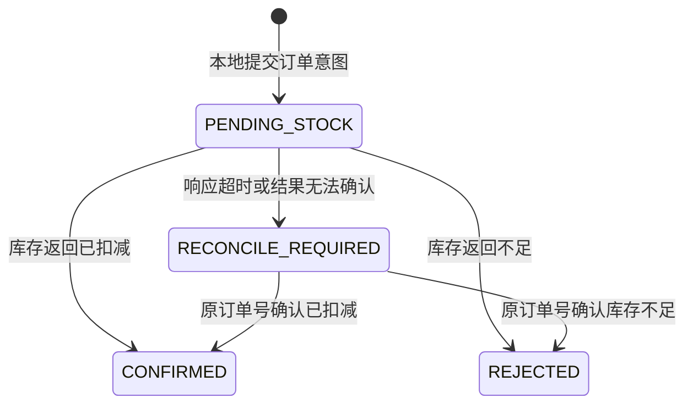

# P3 操作与验证说明

## 实现范围

正常模式提供四个数据服务：用户、商品、库存、订单；Gateway 统一接入。MyBatis-Plus 负责持久化，MapStruct 负责 DTO/Entity/VO
映射，Flyway 管理各服务自己的表结构和样例数据，Redis 提供商品展示缓存。

本阶段订单 `CONFIRMED` 表示已经扣减库存并保存确定结果，尚未包含支付、发货、消息通知和 Seata 全局事务。Sentinel 规则仍保持 P2
的内存方式，本阶段没有实施规则持久化。

## 1. 环境与启动

按 [环境说明](environment.md) 使用完整业务配置，默认 `nacos` profile。每个服务的独立 schema、Entity、Mapper 和 `resources/db/migration` 均保留在所属模块。

初始用户 1 正常、2 禁用；商品 1001 单价 29.90、库存 20，1002 单价 49.90、库存 5。Flyway 不会在重复启动时重置已有数据。手工故障和并发实验需使用独立实验库与限权账号，不能直接重置日常库存。

## 2. 查询与预览

通过 Gateway 查询：

- `GET /api/users/1`：真实数据库用户。
- `GET /api/products/1001`：商品展示查询，可命中 Redis。
- `GET /api/stocks/1001`：数据库库存快照。
- `POST /api/orders/preview`：校验用户、商品和数量，返回数据库单价、金额及库存快照；不写订单或扣库存。

预览请求示例：

```json
{"userId":1,"productId":1001,"quantity":2}
```

库存快照不能保证下一次下单成功。真正扣减时执行条件 SQL `available >= quantity`，由数据库竞争决定是否成功。

网关新增商品、库存展示路由，没有代理 `/internal/**`。内部路径是服务调用约定，当前不等同于身份鉴权；认证依照之前的范围后期加入。

## 3. 正式下单与幂等

```http
POST http://localhost:8100/api/orders
Content-Type: application/json

{"requestNo":"order-demo-0001","userId":1,"productId":1001,"quantity":2}
```

请求号使用 8～64 位小写 ASCII 字母、数字、下划线或短横线。约束统一了数据库排序规则下的键比较语义；建议使用小写
UUID。同号同参数返回原订单，不重新报价、不重复扣库存；同号更换用户、商品或数量返回 40906。

单价由商品服务直接查询数据库取得，订单服务用 `BigDecimal` 计算并保存单价、名称和金额快照，客户端不允许传价格。商品后来改价，也不改变已创建订单的快照。

正常成功返回 `CONFIRMED`。库存不足返回 HTTP 409 / 40902，同时订单保存 `REJECTED`
，可以通过查询接口查看原因。拒绝订单是终态，即使后来补货，用原号重试也不再扣减；如要重新购买，创建新的购买请求。

## 4. 订单状态与恢复



| 状态                 | 含义               | 下一步        |
|--------------------|------------------|------------|
| PENDING_STOCK      | 意图已保存，尚未保存确定库存结果 | 查询或用原号重试   |
| RECONCILE_REQUIRED | 库存结果未知，不能断言库存未扣  | 用原号重试确认    |
| CONFIRMED          | 库存已扣减，订单已确认      | 重复提交只返回原结果 |
| REJECTED           | 库存不足，订单已拒绝       | 原号不再扣库存    |

查询 `GET /api/orders/{orderNo}`；确认未知结果用 `POST /api/orders/{orderNo}/retry`。

订单先提交本地意图，再调用库存。库存服务在同一个本地事务中保存幂等键和扣减结果，重复调用返回原结果。即使库存已经提交、响应却丢失，订单也能用原号重试确认，避免再次扣减。

如果进程在意图保存后退出，或库存成功后订单状态更新失败，订单可能仍为 `PENDING_STOCK`
，同样可以原号恢复。本阶段依赖显式重试，不是自动恢复任务，也不是跨服务统一回滚；P4/P5 分别继续消息与分布式事务实验。

## 5. 商品更新与 Redis

先 `GET /api/products/1001` 取得 version，再更新：

```http
PUT http://localhost:8100/api/products/1001
Content-Type: application/json

{"name":"学习笔记本","price":39.90,"enabled":true,"version":0}
```

旧版本不能覆盖已提交的新版本，返回 40903。更新成功后只在数据库提交完成时切换缓存代际并删除旧代缓存。查询回填通过 Lua
比较代际，避免旧查询在商品更新后重新填入旧代数据。

Redis 键使用项目专属前缀，例如 `cloud-lab:product:{1001}:generation` 和 `cloud-lab:product:{1001}:data:0`。展示缓存 TTL 为
30 秒，代际元数据保留到对应项目键清理。

Redis 连接失败时展示接口回退 MySQL。数据库提交后缓存失效失败，不会假称数据库回滚；旧展示数据最多等待 TTL。下单报价始终通过
`/internal/products/{id}/quote` 查询数据库，因此不依赖展示缓存中的价格。

## 6. 可选故障实验

以下多服务故障实验按需执行，不属于日常启动步骤。使用独立 Group、实验库和 Redis 前缀，核对：

1. 按原号重复下单，只扣一次库存、保存一条幂等记录；同号不同参数返回 409。
2. 更新商品后旧版本更新失败，新展示价格生效；原订单重试仍使用价格快照。
3. 商品服务单独设置不可用 Redis 地址后重启，展示回退数据库。恢复连接后再次确认缓存行为，不停止共享 Redis。
4. 库存服务经调试断点在本地事务提交后、HTTP 返回前暂停超过订单读取超时。订单进入待确认后释放断点，再原号重试，核对库存没有再次下降。注意暂停断点可能让整个 JVM 停止，应只暂停当前线程。
5. 在实验库存库将商品 1002 库存设为 5，并发提交 12 个不同请求号，每单 1 份；未知结果沿原号恢复，最终核对确认数 5、拒绝数 7、库存 0。

并发请求可在 IDEA HTTP Client 中分别提交，也可用终端并发 curl；参数总数与请求号必须明确记录。实验后恢复自己调整的参数和进程。

## 历史验收

2026-10-12 已验证真实 MySQL / Redis 多服务下单、缓存失效、提交后响应丢失与并发防超卖。该记录为历史多服务故障验收，接口验证入口见 [接口验证说明](verification.md)。
