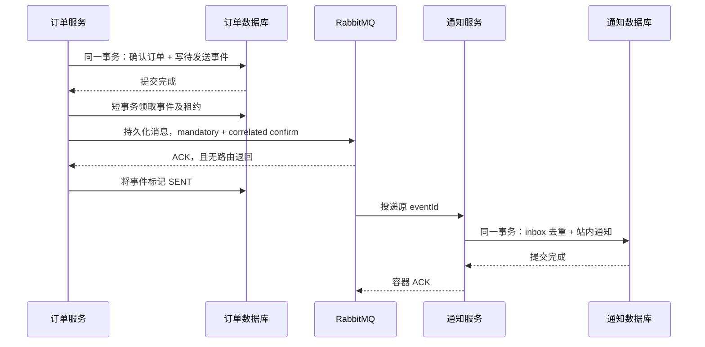

# P4：订单事件、重试和死信

## 业务范围

正式下单沿用 P3 的同步用户校验、数据库报价和幂等扣库存。只有订单首次从待确认变成 `CONFIRMED` 时产生 `ORDER_CONFIRMED` V1
事件，通知服务异步创建一条站内通知。

`CONFIRMED` 表示库存确认完成；`SENT` 表示 RabbitMQ 接收了事件；通知接口返回记录，才表示该消费端完成业务写入。三者分别查询，不用消息成功替代订单状态，也不把站内记录说成短信或邮件送达。

新增模块：

| 模块                    | 职责                                        |
|-----------------------|-------------------------------------------|
| `cloud-order-api`     | 不可变事件契约，不共享订单 Entity/Mapper               |
| `cloud-common-rabbit` | Spring AMQP 和项目拓扑声明，网关及其他数据服务不引入          |
| `cloud-notification`  | 独立部署，默认 8105；自己的 `cloud_notification` 数据库 |

## 为什么要有发件箱

直接在订单事务前后调用 RabbitMQ 都有失败窗口：数据库提交但消息未发出，或者消息发出但订单事务回滚。本项目在订单确认的同一个
MySQL 事务里写入 `lab_order_outbox`，网络投递发生在该事务提交后。



RabbitMQ 暂时不可用不回滚已确认订单，事件持久化后按策略重试。发件箱写入失败会回滚本次确认状态；P3
已保存的订单意图与库存幂等记录仍可用原订单号恢复。跨服务订单/库存全局回滚留到 P5。

V2 migration 不给历史已确认订单自动补发事件，避免升级时突然发送历史通知。新确认及待确认订单恢复按上述路径产生事件。

## 环境与启动

按 [环境说明](environment.md) 准备 `cloud_notification` 和项目 RabbitMQ vhost，再启动六个服务。订单、通知显式导入 `config/messaging.yml`，其余服务不引入消息依赖。账号及密码通过环境变量提供。

## 请求示例

```http
POST http://localhost:8100/api/orders
Content-Type: application/json

{"requestNo":"order-p4-demo-0001","userId":1,"productId":1001,"quantity":1}
```

然后查询：

| 接口                                                   | 结果                               |
|------------------------------------------------------|----------------------------------|
| `GET /api/orders/order-p4-demo-0001`                 | 同步订单状态                           |
| `GET /api/orders/events/by-order/order-p4-demo-0001` | 确认事件列表；未确认时为空                    |
| `GET /api/orders/events/{eventId}`                   | 投递状态、次数、下一次时间和公开错误               |
| `GET /api/notifications/orders/order-p4-demo-0001`   | 已创建站内通知；尚未处理为 HTTP 404 / 40408   |
| `POST /api/orders/events/{eventId}/retry`            | 原事件重新安排；正在投递或 SENT 返回 40907      |
| `POST /api/notifications/dead-letters/replay-one`    | 修复消费故障后重放一条死信；空队列 replayed=false |

重试订单与重试事件是不同操作。订单待确认使用 P3 的 `/orders/{orderNo}/retry`
；订单已确认但消息未发成功，使用事件重试入口。消息重试不重新扣库存，不重新计算金额，也不改变事件 ID/JSON。

## 发布端：有限重试、租约和未知结果

发件箱状态为 `PENDING → PUBLISHING → SENT`，失败回到 `PENDING`，最多自动尝试 8 次后为 `FAILED`。默认每秒扫描最多 20 个事件，单次
broker 确认等待 5 秒、租约 30 秒。重试间隔从 2 秒指数增长，最高 60 秒。

数据库条件更新领取租约。多个订单服务实例同时运行时只有当前令牌能写回成功或失败。进程领取后崩溃，租约到期可由其他实例重新领取；最后一次尝试崩溃也会转为
FAILED，可人工重新安排。

发布使用 persistent 消息、correlated confirms、returns 和 mandatory。没有路由的消息可能收到 ACK，同时被退回，所以两项都检查。只收到
ACK 不代表消费者完成业务。

收到 ACK 后、本地写 SENT
前崩溃，会再次发布原事件。这里使用至少一次投递与消费幂等，不承诺消息只出现一次。[Spring AMQP confirms/returns 说明](https://docs.spring.io/spring-amqp/reference/amqp/template.html)。

发件箱时间使用 UTC；公开状态不返回租约令牌、完整消息内容或连接地址。HTTP 请求 ID 随事件进入发布和消费日志。

## 消费端：事务提交后 ACK

消费者先校验固定 V1 契约、messageId/eventId、快照金额及字段，再在同一数据库事务写入 `lab_message_inbox` 和
`lab_order_notification`。业务写入失败时 inbox 也回滚，后续消费仍可处理。

inbox 的事件 ID 唯一键防止重复处理；已处理 ID 的 JSON 摘要必须一致。通知的订单号唯一键进一步防止不同事件为同一订单创建两条记录。数据库提交后
ACK 失败导致重投时，去重分支正常返回原结果。

监听容器配置 `acknowledge-mode: auto`：Spring 容器在监听方法成功返回后发送协议 ACK，RabbitMQ 仍使用需要 ACK
的投递模式。监听器调用独立事务服务，事务提交失败会向容器抛出异常，不吞异常假称成功。

单次投递最多尝试 3 次，间隔 500ms / 1s。耗尽后 `RejectAndDontRequeueRecoverer` 明确 reject，不立即 requeue；broker
执行死信路由。短期重试在当前消费线程执行，适合本项目有限消息量，未实现延迟队列或无限重试。

## 死信与人工重放

主队列、死信队列为持久化 quorum 队列。主队列配置 `x-dead-letter-strategy=at-least-once`、`x-overflow=reject-publish` 和
DLX，最多积压 10000 条；达到容量导致 broker NACK
时，发布端保留事件继续按策略处理。[RabbitMQ 4.1 至少一次死信说明](https://www.rabbitmq.com/docs/4.1/quorum-queues#dead-lettering)。

| 类型    | 默认名称                                          |
|-------|-----------------------------------------------|
| 主交换机  | cloud.lab.order.events.v1                     |
| 主队列   | cloud.lab.notification.order-confirmed.v1     |
| 主路由键  | order.confirmed.v1                            |
| 死信交换机 | cloud.lab.order.events.dlx.v1                 |
| 死信队列  | cloud.lab.notification.order-confirmed.dlq.v1 |

死信队列不自动消费或自动无限重放。先查看消息与服务日志，修复数据库或业务故障，再调用单条重放接口。重放在 broker
确认原内容已重新发布、且无路由退回后才 ACK 原死信；结果未知时可能重复，由 inbox 保护。重放成功只表示 broker 接收，仍需查询通知结果。非法
JSON 或错误契约应先排查产生方，直接原样重放会再次进入死信。

当前 OrbStack 为单节点 RabbitMQ，quorum 队列提供持久化语义；没有验证多节点容灾。事件与 inbox 没有自动历史清理任务，保留全部记录以便复习排查。

## 可选故障实验

以下 RabbitMQ 故障实验按需执行，不属于日常启动步骤。

手工消息故障实验使用五个实验库、独立 Nacos Group、独立 Redis 前缀和 RabbitMQ vhost。每个服务的 `DB_SCHEMA` 单独指向对应实验库，RabbitMQ 项目账号只获得实验 vhost 的权限；不要让测试订单进入日常通知队列。

逐项复现：

| 场景 | 操作 | 核对结果 |
| --- | --- | --- |
| 正常与重复下单 | 原号重复提交，查询事件及通知 | 一次扣减，一条事件，一条通知 |
| 消费端停止 | 只停止实验通知进程，下单后重启 | 事件可 SENT，队列积压后恢复消费 |
| mandatory 路由退回 | 在实验 vhost 暂时移除主队列绑定，提交新订单 | 事件不能标记 SENT；恢复绑定后重试 |
| 发布连接故障 | 仅实验订单进程配置不可用 RabbitMQ 端口 | 数据库保留待发送事件；恢复后投递 |
| 租约恢复 | 将实验库事件设为过期 PUBLISHING，重启发布进程 | 重新领取可重投，通知仍幂等 |
| 消费失败与死信 | 在实验通知表添加拒绝写入的临时约束 | 有限重试后进入死信，inbox 不提交 |
| 修复与重放 | 删除临时约束，调用 replay-one，查询通知 | 原事件内容被重放，最多一条通知 |

消费失败可使用 `ALTER TABLE lab_order_notification ADD CONSTRAINT ck_manual_failure CHECK (total_amount < 0)`，仅在没有已有通知的实验库执行；修复使用 `ALTER TABLE lab_order_notification DROP CHECK ck_manual_failure`。用新订单验证，避免 inbox 已记录的重复事件绕过业务写入。

实验后恢复绑定、删除临时约束、停止实验进程，并按需清理实验资源。不要停止共享 RabbitMQ，不操作其他 vhost 或执行全库清理。

## 历史验收

2026-10-13 已完成真实 confirms/returns、重复消费、发布连接故障、租约恢复、有限重试、死信和同 ID 重放。该记录为历史 broker 故障验收，接口验证入口见 [接口验证说明](verification.md)。
