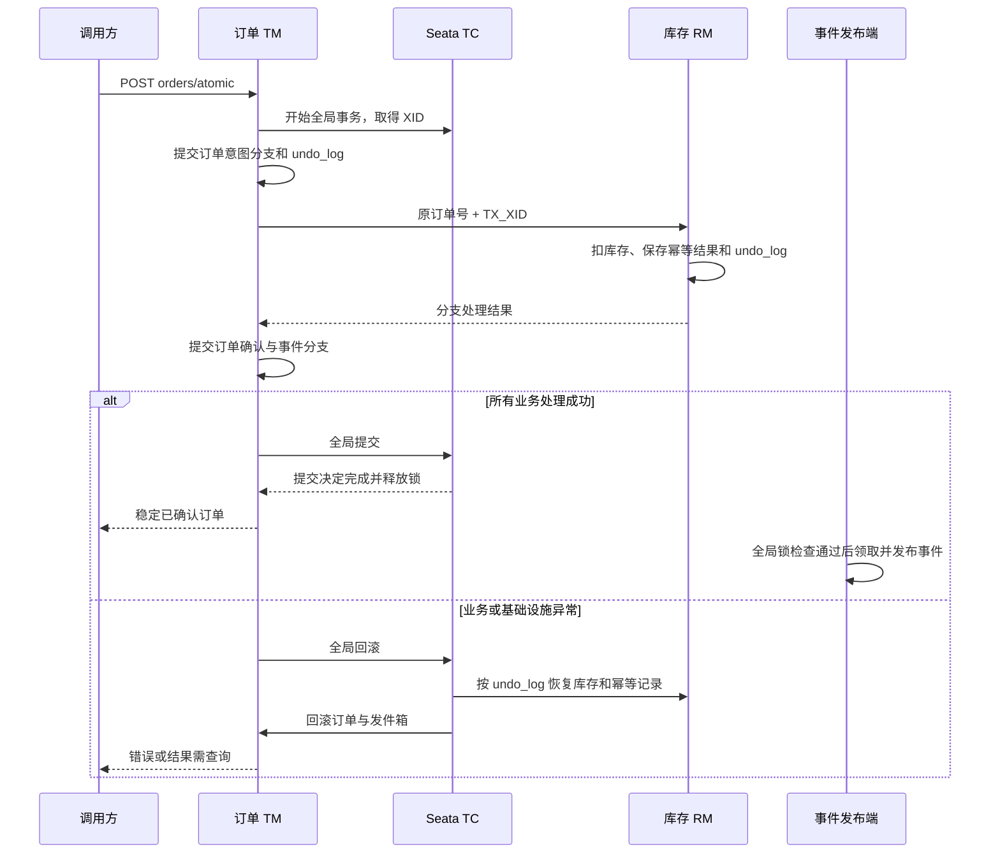

# P5：Seata AT 同步下单

## 业务入口与范围

P5 新增 `POST /api/orders/atomic`，使用 Seata AT 将订单意图、库存扣减及其幂等记录、订单确认和待发送事件纳入一个全局事务。

原有 `POST /api/orders` 继续使用 P3/P4 的本地事务与未知结果恢复流程。订单和库存记录新增 `transaction_mode`，分别为
LOCAL/GLOBAL；相同请求号不能跨模式使用。

| 对象               | 是否参与本次全局事务    |
|------------------|---------------|
| 订单意图、确认状态        | 是，订单库 AT 分支   |
| 库存数量、幂等扣减记录      | 是，库存库 AT 分支   |
| 订单发件箱            | 是，与订单确认同一本地分支 |
| 用户、商品报价          | 只读校验，保留下单快照   |
| Redis 展示缓存       | 不参与回滚         |
| RabbitMQ 发布与通知消费 | 全局提交后再异步处理    |

`CONFIRMED` 仍表示库存与订单确认完成，不代表支付或发货。

## 环境与启动

按 [环境说明](environment.md) 准备 Seata 2.5.0 TC。订单、库存显式导入 `config/seata.yml`，设置 `SEATA_ENABLED=true`、Nacos 地址和对应的 TC 注册信息；其他服务不引入 Seata。

服务端和客户端均使用 Nacos 注册发现，Seata 配置仍从本地文件读取。默认 TC 为 public 命名空间、`SEATA_GROUP` 中的 `seata-server`，`lab_tx_group` 映射 `default` 集群。服务启动前核对 TC 的健康实例与公布地址，再检查客户端实际连接，详细变量见 [环境说明](environment.md#seata-注册发现)。

## 表结构与第一次启动

订单库 `V3__seata_at.sql`、库存库 `V2__seata_at.sql` 各自创建 `undo_log`，并增加事务模式和 XID 字段；旧记录默认
LOCAL。undo_log 使用 Seata 2.5 官方客户端 MySQL
所需结构。[官方建表结构](https://github.com/apache/incubator-seata/blob/v2.5.0/script/client/at/db/mysql.sql)。

初始化顺序是：原始 Hikari 连接池执行 Flyway，迁移成功后创建唯一的 `DataSourceProxy`，业务
MyBatis/JDBC/事务管理器使用该代理。关闭自动二次代理，避免首次启动尚无 undo_log 和重复代理问题。

已执行的 migration 保持原始内容与校验值。以后变更结构应新增 migration，不格式化已经执行的版本。

## 下单和重复提交

```http
POST http://localhost:8100/api/orders/atomic
Content-Type: application/json
X-Request-Id: order-p5-demo-0001

{"requestNo":"order-p5-demo-0001","userId":1,"productId":1001,"quantity":2}
```

响应包含 `transactionMode=GLOBAL` 和 `globalXid`。`globalXid` 用于关联订单分支、库存分支和 undo_log；HTTP 请求 ID 继续关联应用日志。

订单 TM 的独立 Bean 方法使用 `@GlobalTransactional(rollbackFor=Exception.class)`，超时 30 秒。Feign 传递 `TX_XID`，库存 AT
内部入口绑定 RootContext，处理完成或异常时清理当前线程。普通库存路径不接受外部 XID 变成全局分支。写请求不自动重试。

全局代理完成提交后，再读取通过全局锁检查的稳定订单，才返回 HTTP 200。相同号相同参数的已提交 GLOBAL 订单返回原快照，不重复扣减或发事件；参数变化返回
40906，跨 LOCAL/GLOBAL 使用返回 40908。其他未完成事务占用同号时不能接管其分支，需稍后查询。

## 成功、回滚与未知结果



库存不足会触发整个全局事务回滚，GLOBAL 路径不保留 P3 LOCAL 路径的 REJECTED 订单。订单意图、库存拒绝记录一起撤销；只有全局成功的订单产生可发送事件。

库存分支已提交但 HTTP 响应丢失，也不能忽略异常继续确认。异常离开全局代理，由 TC 回滚已注册的两个服务分支。

HTTP 503 不等于“确定已回滚”。TC 连接、超时、回滚重试或响应未知时，要保留原请求号查询。`GET /api/orders/{orderNo}` 对 GLOBAL
行执行全局锁检查，避免把 AT 一阶段的已确认行误当作最终结果。

回滚完成后订单可能不存在；需要重新购买时通过 `/api/orders/atomic` 沿用原号确认。已提交订单保留原价格快照；已完全回滚的重试属于新的全局事务，重新校验当前用户与商品报价。不要用
LOCAL 的 `/orders/{orderNo}/retry` 接管 GLOBAL 订单。

全局事务保护的是参与代理的数据库写入。恢复仍由 TC 与 RM 完成，遇到未完成的锁或基础设施故障时不假称整体已成功。

## 发件箱为什么还要全局锁

AT 一阶段本地提交后，其他数据库连接已经可以看到订单和发件箱。此时全局事务仍可能回滚；提前把事件发到 RabbitMQ
会生成无法由数据库回滚撤销的通知。

发件箱领取和人工重试使用 `@GlobalLock`，领取的本地事务提交前检查事件行的 Seata 全局锁。全局事务未完成时领取不会提交，消息不会发送。提交完成后才正常执行
P4 的 confirms/returns
和幂等消费；回滚则移除订单、事件及库存分支数据。[Seata AT 事务隔离说明](https://seata.apache.org/docs/user/appendix/isolation/)。

LOCAL 库存写入也执行全局锁检查，避免同一商品在 GLOBAL 分支未完成时被本地流程改写。库存幂等插入使用普通
INSERT，重复键读取带锁的原记录，不依赖 INSERT IGNORE 生成 AT 镜像。

## 基础接口验证

使用 [requests.http](requests.http) 或 Swagger：

| 场景 | 操作 | 预期结果 |
| --- | --- | --- |
| 全局提交 | 新请求号提交 GLOBAL 订单，查询订单、库存和通知 | 订单 CONFIRMED、模式 GLOBAL、有 XID，库存按数量下降，异步生成通知 |
| 原号幂等 | 原号、原参数再次提交 | 返回原订单，库存不再次下降，事件和通知不重复 |
| 库存不足 | 购买数量超过当前库存且满足数量上限 | 订单、库存幂等记录和事件回滚，不生成通知 |
| 模式隔离 | LOCAL 已用请求号提交到 GLOBAL | 返回 40908，不接管原订单 |

库存不足可在初始数据中使用商品 1002、数量 6（初始库存 5，默认购买上限 10）；如果库存或数量限制已调整，按实际值选择。保留原请求号查询最终状态，HTTP 503 不能直接证明已经回滚。

## 可选故障实验

需要深入观察跨服务回滚时，再准备独立实验库、Nacos Group、Redis 前缀、RabbitMQ vhost 和实验 Java 进程。这些步骤不属于日常启动的前置条件。

1. **库存成功后发件箱写入失败**：在空的实验订单库执行 `ALTER TABLE lab_order_outbox ADD CONSTRAINT ck_atomic_failure CHECK (attempts < 0)`，使用新号全局下单，核对库存恢复、订单与事件撤销。完成后执行 `ALTER TABLE lab_order_outbox DROP CHECK ck_atomic_failure`。
2. **库存分支提交后响应丢失**：仅暂停实验库存线程的返回阶段，使其超过 Feign 超时，再释放断点；沿原号查询并等待 TC 恢复。只暂停当前线程，避免整个 JVM 停止造成额外故障。

全局事务完成前的事件发布保护由前述全局锁机制实现，可结合应用日志和相关代码理解。当前接口实验不单独覆盖全局事务暂停期间的发布时序。

## 历史验收

2026-10-13 已完成真实 AT 注册、成功幂等、分支 SQL 失败回滚、库存不足、响应丢失，以及全局事务未完成时不发送、回滚不通知、提交后消费的发布时序验证。

该记录描述当时的验收结果，不代表当前接口实验覆盖所有场景。接口验证入口见 [接口验证说明](verification.md)。

## Nacos 注册发现验证

2026-10-13：使用已有 Nacos / TC 与随机隔离实验库完成联调。订单和库存客户端通过 public / SEATA_GROUP / seata-server / default 获取 TC 地址，启动日志确认连接到 Nacos 公布的地址；GLOBAL 下单及重复提交只扣一次库存，真实 RabbitMQ 通知消费成功。LOCAL 路径同时完成联调。

临时实验库、账号、Nacos 业务配置和消息 vhost 已清理。该次联调未修改现有 TC，也未启动 Compose。后续于同日完成独立 Compose 从全新数据卷初始化、鉴权注册、GLOBAL 下单、消息消费与库存不足回滚，详见 [接口验证说明](verification.md)。
